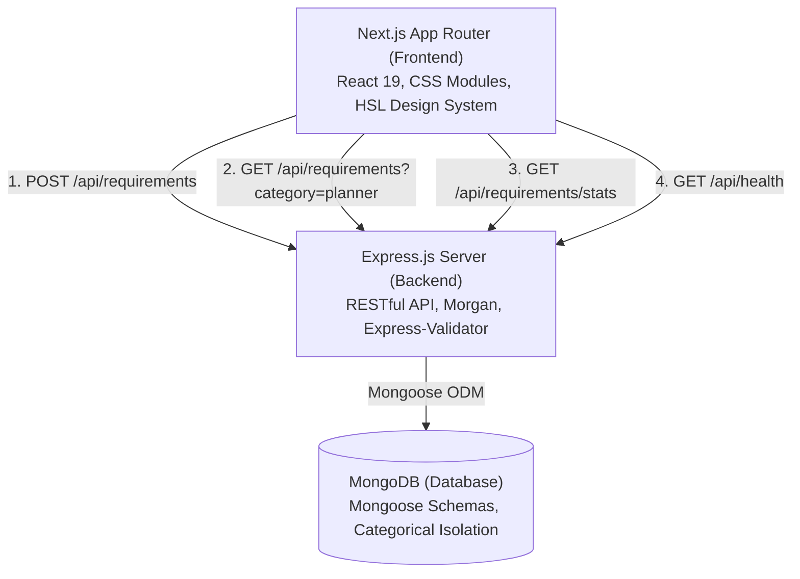

# GoPratle Requirement Posting Flow 🚀

A production-grade, full-stack event requirement posting engine built for the **GoPratle Technical Assessment (Full-Stack Developer Intern)**.

This system empowers event organizers to dynamically post requirements with a 4-step adaptive flow tailored specifically for **Event Planners**, **Performers**, and **Production Crew**, persisting cleanly categorised data into **MongoDB** with real-time validation and a live submission dashboard.

---

## 🌟 Key Highlights & Features

- **Multi-Step Adaptive Form Wizard**:
  - **Step 1 - Event Basics**: Event name, event type (chips & presets), multi-day toggle with start & end dates, location (city & state), venue details, and interactive category selection cards (Event Planner, Performer, Crew).
  - **Step 2 & Step 3 - Category-Specific Fields (Adaptive Dynamic Steps)**:
    - **Event Planner**: Planning scope (Full, Partial, Day-of, Decor-only), guest scale, theme aesthetics, budget range (₹ INR), service checklists, planner experience tiers, on-site coordinator languages, moodboard link, milestones, and cultural/dietary notes.
    - **Performer**: Role/act (Live Band, Solo Acoustic, DJ, Comedian, Anchor, Dancer, Celebrity), music genres & styles, stage duration, audience vibe, sound equipment provision toggle, backline instruments, custom song request policy, honorarium budget, and hospitality riders.
    - **Crew**: Technical discipline (Sound Engineer, Lighting Tech, Videographer, Camera Crew, Stage Hand, Security), headcount, call time, shift duration, overnight breakdown toggle, dress code, skill level, gear ownership, day/hourly rate, and safety protocols.
  - **Step 4 - Review & Submission**: Real-time structured summary with 1-click edit shortcuts, poster contact details (Name, Organization, Email, Phone), requirement urgency level badge, client-side validation, and instant persistence to MongoDB.
- **MongoDB Data Isolation & Schema Design**:
  - Stored under a strict categorisation pattern where non-selected category subdocuments remain `undefined` in the database, avoiding schema pollution.
  - Automatically generates human-readable unique reference codes (e.g. `GP-PLN-2026-17005`, `GP-PRF-2026-68229`, `GP-CRW-2026-74136`).
- **Live Submission Dashboard & Inspector**:
  - Real-time explorer to inspect all posted requirements directly from MongoDB.
  - Metric counters (Total, Planners, Performers, Crew) and category filter tabs.
  - Live search by event name, city, reference ID, and poster name.
  - Expandable modal with raw MongoDB JSON inspector and live workflow status updater (`Open` -> `Under Review` -> `Fulfilled` -> `Closed`).
- **1-Click Demo Presets**:
  - Top navigation dropdown allowing reviewers to auto-fill complete sample data for **Planner**, **Performer**, or **Crew** in 1 click!
- **Autosave Drafts**:
  - Form state automatically syncs to `localStorage` so user progress is never lost on reload.
- **Automated Backend Test Suite**:
  - 8/8 passing automated tests in Jest + Supertest with MongoMemoryServer covering all category creations, validation failures, filtering, search, and metrics.

---

## 🏗️ Architecture & Tech Stack



### Frontend
- **Framework**: [Next.js](https://nextjs.org/) (App Router, JavaScript/JSX)
- **Styling**: Modern CSS Modules + Custom Design Tokens (HSL palette, glassmorphism, responsive typography, micro-animations)
- **Icons**: [Lucide React](https://lucide.dev/)
- **State & Storage**: React Hooks (`useState`, `useEffect`) + `localStorage` draft synchronization

### Backend
- **Runtime**: Node.js (ES Modules `import/export`)
- **Web Framework**: Express.js
- **Database & ODM**: MongoDB + [Mongoose](https://mongoosejs.com/)
- **Validation**: Custom structural & business validation middleware
- **Testing**: Jest + Supertest + [mongodb-memory-server](https://github.com/nodkz/mongodb-memory-server)

---

## 📁 Repository Structure

```
GoPratle/
├── client/                               # Next.js Frontend Application
│   ├── src/
│   │   ├── app/
│   │   │   ├── layout.js                 # Global HTML & SEO meta tags
│   │   │   ├── page.js                   # Master 4-step wizard & dashboard switcher
│   │   │   ├── page.module.css           # Glassmorphic wizard container styles
│   │   │   └── globals.css               # Core design tokens, HSL colors, animations
│   │   ├── components/
│   │   │   ├── Navbar/                   # Brand logo, live DB status indicator, demo presets
│   │   │   ├── Stepper/                  # Adaptive 4-step progress bar
│   │   │   ├── CategoryPicker/           # Visual selector cards for Planner, Performer, Crew
│   │   │   ├── Steps/
│   │   │   │   ├── Step1Basics.jsx       # Event name, dates, city, venue, category
│   │   │   │   ├── Step2Planner.jsx      # Planner scope, guest scale, theme, budget
│   │   │   │   ├── Step3Planner.jsx      # Planner tier, languages, milestones, notes
│   │   │   │   ├── Step2Performer.jsx    # Performer role, genres, duration, vibe
│   │   │   │   ├── Step3Performer.jsx    # Sound equipment, backline gear, rider notes
│   │   │   │   ├── Step2Crew.jsx         # Discipline, headcount, call time, dress code
│   │   │   │   ├── Step3Crew.jsx         # Crew skill level, gear ownership, rates
│   │   │   │   └── Step4Review.jsx       # Structured preview & poster contact form
│   │   │   ├── SuccessModal/             # Confirmation popup with reference ID copy & JSON export
│   │   │   └── LiveDashboard/            # Real-time MongoDB requirements feed & JSON inspector
│   │   ├── services/
│   │   │   └── api.js                    # Fetch client for backend API endpoints
│   │   └── utils/
│   │       ├── validation.js             # Client-side step validation logic
│   │       └── presets.js                # Demo test presets (Planner, Performer, Crew)
│   ├── package.json
│   └── next.config.mjs
├── server/                               # Express + MongoDB Backend Application
│   ├── src/
│   │   ├── config/
│   │   │   └── db.js                     # Mongoose connection & disconnect helpers
│   │   ├── models/
│   │   │   └── Requirement.js            # Mongoose schema with category sub-schemas
│   │   ├── controllers/
│   │   │   └── requirementController.js  # CRUD & analytics operations
│   │   ├── routes/
│   │   │   ├── requirementRoutes.js      # REST routes for requirements
│   │   │   └── healthRoutes.js           # Server & MongoDB health check endpoint
│   │   ├── validators/
│   │   │   └── requirementValidator.js   # Payload validation logic
│   │   ├── utils/
│   │   │   └── referenceGenerator.js     # Unique reference ID generator
│   │   ├── middlewares/
│   │   │   └── errorHandler.js           # Centralized error & 404 handlers
│   │   ├── app.js                        # Express app instance & CORS configuration
│   │   └── server.js                     # Server entry point & graceful shutdown
│   ├── tests/
│   │   └── requirements.test.js          # Automated Jest/Supertest suite
│   ├── package.json
│   └── .env.example
├── WALKTHROUGH_SCRIPT.md                 # 5-7 minute video recording walkthrough script
├── package.json                          # Monorepo root scripts
└── README.md
```

---

## ⚡ Quick Start Guide (Local Setup)

### Prerequisites
- Node.js (v18 or higher; tested on Node v24)
- npm (v9 or higher)
- Local MongoDB running on `mongodb://localhost:27017` OR a free MongoDB Atlas connection string

### 1. Clone the Repository
```bash
git clone <your-github-repo-url>
cd GoPratle
```

### 2. Configure Environment Variables

**Backend (`server/.env`)**:
```env
PORT=5000
MONGODB_URI=mongodb://localhost:27017/gopratle_db
CORS_ORIGIN=http://localhost:3000
NODE_ENV=development
```

**Frontend (`client/.env.local`)**:
```env
NEXT_PUBLIC_API_URL=http://localhost:5000/api
```

### 3. Install Dependencies
```bash
npm run install:all
```
*(Or install separately: `cd server && npm install` and `cd client && npm install`)*

### 4. Run Backend & Frontend

**Terminal 1 (Backend Server)**:
```bash
npm run dev:backend
# Server runs at http://localhost:5000
```

**Terminal 2 (Frontend Client)**:
```bash
npm run dev:frontend
# App runs at http://localhost:3000
```

Open [http://localhost:3000](http://localhost:3000) in your browser!

### 5. Run Automated Tests
```bash
npm run test:backend
```
Expected output:
```
PASS tests/requirements.test.js
  Requirements API
    GET /api/health
      ✓ should return healthy status
    POST /api/requirements
      ✓ should create an Event Planner requirement successfully
      ✓ should create a Performer requirement successfully
      ✓ should create a Crew requirement successfully
      ✓ should reject invalid payload with missing event basics and invalid email
    GET /api/requirements and filtering
      ✓ should filter by category=planner
      ✓ should filter by search keyword
      ✓ should return metrics at /api/requirements/stats

Test Suites: 1 passed, 1 total
Tests:       8 passed, 8 total
```

---

## 📡 API Reference

### Base URL: `http://localhost:5000/api`

| Method | Endpoint | Description | Query / Body Params |
|---|---|---|---|
| `GET` | `/health` | Health check & DB status | None |
| `POST` | `/requirements` | Create requirement | JSON payload (eventBasics, category, details, contactPerson) |
| `GET` | `/requirements` | List requirements with filters | `?category=planner&search=wedding&page=1&limit=10` |
| `GET` | `/requirements/stats` | Aggregate metrics by category & status | None |
| `GET` | `/requirements/:id` | Get requirement by ID or reference ID | `:id` (e.g. `GP-PLN-2026-17005` or Mongo `_id`) |
| `PATCH` | `/requirements/:id/status`| Update requirement status | `{ "status": "Under Review" }` |
| `DELETE` | `/requirements/:id` | Delete requirement | `:id` |

---

## ☁️ Deployment Instructions

### Frontend (Vercel)
1. Push repository to GitHub.
2. Import repository in [Vercel](https://vercel.com).
3. Set the Root Directory to `client`.
4. Configure Environment Variable:
   - `NEXT_PUBLIC_API_URL`: Your deployed backend URL (e.g. `https://gopratle-api.onrender.com/api`).
5. Deploy!

### Backend (Render / Railway / DigitalOcean)
1. In [Render](https://render.com), create a new **Web Service**.
2. Set Root Directory to `server`.
3. Build Command: `npm install`
4. Start Command: `node src/server.js`
5. Environment Variables:
   - `PORT`: `5000`
   - `NODE_ENV`: `production`
   - `MONGODB_URI`: MongoDB Atlas connection string (`mongodb+srv://<user>:<password>@cluster0.mongodb.net/gopratle_db?retryWrites=true&w=majority`)
   - `CORS_ORIGIN`: Your deployed Vercel frontend URL.

---

## 🎥 Screen Recording Walkthrough Guide

Refer to [`WALKTHROUGH_SCRIPT.md`](./WALKTHROUGH_SCRIPT.md) for the exact 5-7 minute speaking outline covering:
1. Understanding & Architectural Decisions
2. Live Application Flow (Step 1 -> Dynamic Step 2 & 3 -> Step 4 -> MongoDB confirmation)
3. API & Data Flow Analysis
4. Testing, Edge Cases, Limitations & Future Enhancements
